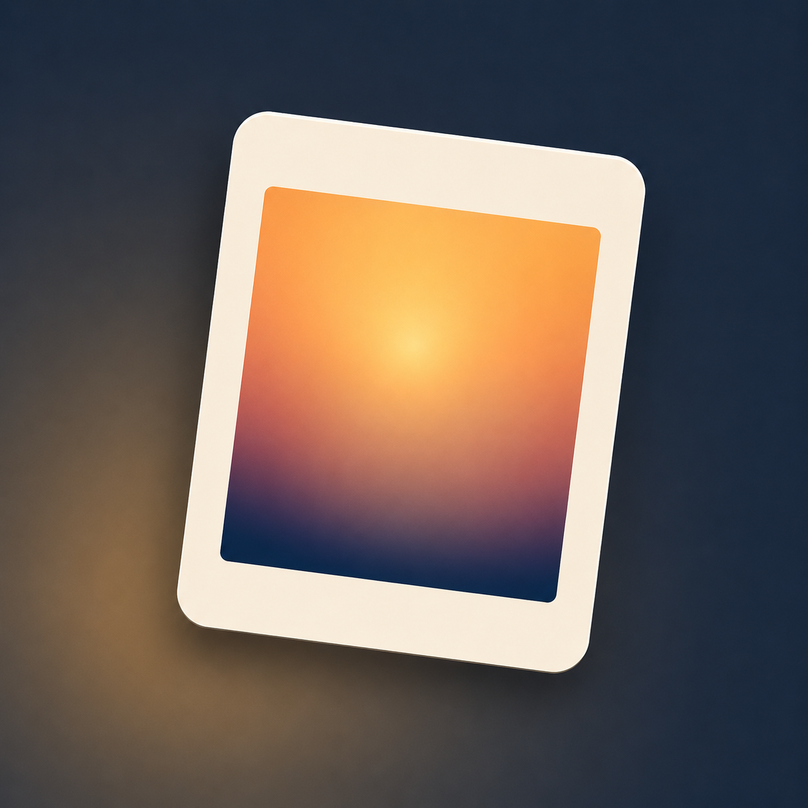

  

<h1 align="center">Tumble</h1>

<strong>Your private film camera and Studio.</strong>

Capture something new or import a favorite, preview one of 21 film looks, edit
the composition, and save a finished photo. Six looks are free; Tumble Complete
unlocks fifteen more with one $4.99 purchase.

## Product contract

- Native iOS and Android apps with the same camera → Studio workflow.
- Real-time film preview, intensity, rotation, crop, and four postcard frames.
- Photo pixels, draft sources, crops, and notes stay on-device.
- One recoverable private draft; no social feed, photo cloud, ads, or watermark.
- Camera, import, editing, and saving are account-free.
- Optional Apple or Google sign-in links purchase ownership across platforms.
- Apple and Google process payments; RevenueCat synchronizes entitlement state.

## Repository

- `app/` — SwiftUI iOS app and XcodeGen project.
- `android/` — Kotlin and Jetpack Compose Android app.
- `shared/` — versioned 21-stock film manifest used by both apps.
- `web/` — product website, privacy policy, terms, and support.
- `marketing/` — current product claims and release assets.

The retired daily roll, shake-to-develop flow, and Drawer remain only as a
read-only legacy path for existing iOS photos.
